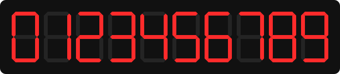
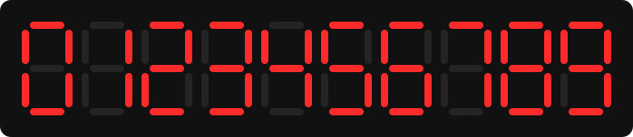
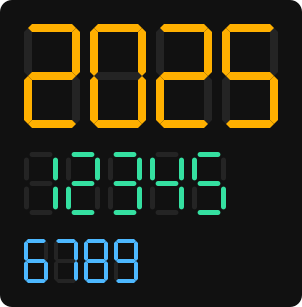

# A Seven Segment Display Component for Vue.js

<p align="center">
  
</p>

<p align="center">
  
</p>

Renders a single digit (0-9) as an inline SVG. Written in TypeScript, ships ESM + CJS builds with type definitions. Requires Vue 3.

### Installation

```
npm install vue-seven-segment-display
```

### Usage

```vue
<script setup>
import { SevenSegmentDisplay } from 'vue-seven-segment-display';
</script>

<template>
  <SevenSegmentDisplay :value="8" :rounded="false" :segment-width="25" :segment-height="5" on-color="#f00" off-color="transparent" />
</template>
```

A default export is also available, and the component can be registered globally with `app.component('SevenSegmentDisplay', SevenSegmentDisplay)`. For multi-digit numbers, render one component per digit:

```vue
<SevenSegmentDisplay v-for="(digit, i) in String(1234)" :key="i" :value="digit" />
```

### Examples

<p align="center">
  
</p>

### Props

| Prop | Type | Default | Description |
| --- | --- | --- | --- |
| `value` | `string \| number` | `0` | Digit from 0 to 9. Anything else throws a `RangeError`. |
| `segment-width` | `number \| string` | `25` | Length of a segment, in px. |
| `segment-height` | `number \| string` | `5` | Thickness of a segment, in px. |
| `on-color` | `string` | `'#f00'` | Colour of lit segments. |
| `off-color` | `string` | `'transparent'` | Colour of unlit segments. |
| `rounded` | `boolean` | `false` | `true` draws rounded segments, `false` draws pointy ones. |

Attributes such as `class` and `style` fall through to the root `<svg>`. The overall size is `(segment-width + 2 * segment-height)` by `(2 * segment-width + 3 * segment-height)` px; to scale it, set a CSS `width` and `height` (the `viewBox` keeps proportions).

### Migrating from 2.x

- Vue 3 is required. Vue 2 users should stay on 2.x.
- The `unpkg`/script-tag build (`window.SevenSegmentDisplay`) is gone. Use a bundler or an ESM-aware CDN.
- `import SevenSegmentDisplay from 'vue-seven-segment-display'` still works, and the named export is new. CommonJS users now use `require('vue-seven-segment-display').default` or the named export.
- The component renders an `<svg>` rather than nested `<div>`s. Rounded segments are now pill-shaped with a small gap between them.
- An invalid `value` now throws a `RangeError`. Previously it silently showed `0`.

### Development

```
npm run dev        # playground at http://localhost:5173
npm test           # vitest
npm run typecheck
npm run build      # outputs dist/
npm run images     # regenerates the SVGs in docs/ from the built component
```
